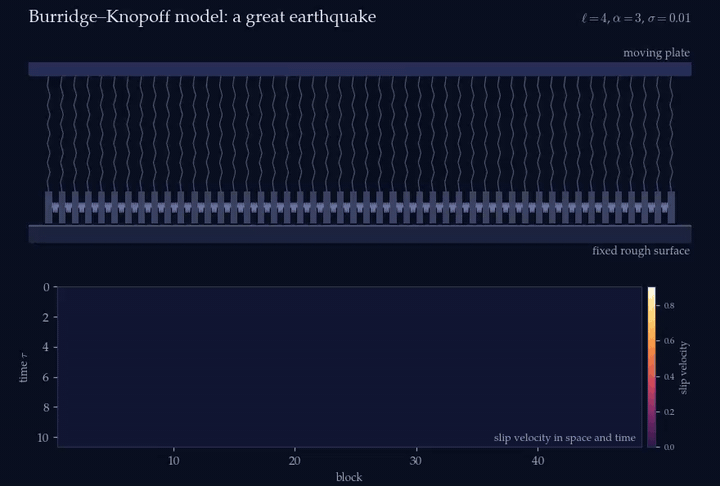
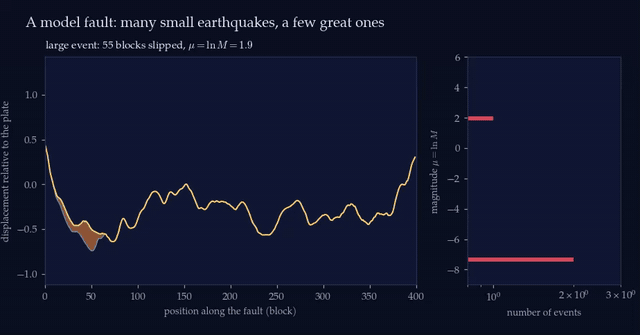
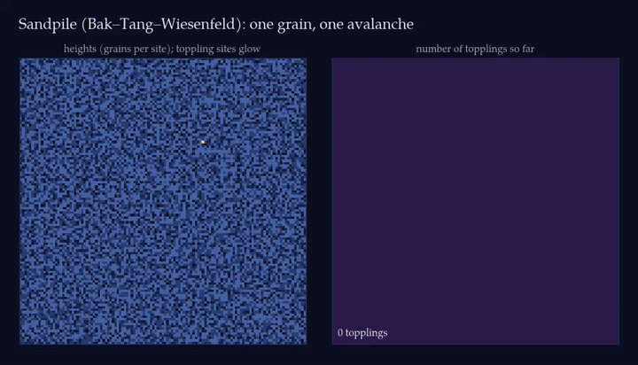

<div align="center">

# Earthquakes, Sandpiles and Self-Organized Criticality

**Can the statistics of a one-dimensional earthquake fault model be understood as a sandpile?**



*A great earthquake in the Burridge–Knopoff model. Top: blocks (coloured by slip velocity) on a rough surface,
pulled by a slowly moving plate. Bottom: slip velocity in space and time — two pulses run outward from the
epicentre at the sound speed and grow as they go.*

[](pyproject.toml)
[](https://numba.pydata.org)
[](tests)
[](LICENSE)

</div>

---

## The question

Earthquake sizes follow the Gutenberg–Richter law: a power law with no characteristic scale. Two classic
models try to explain it:

* the **Burridge–Knopoff (BK) model** — a chain of blocks and springs dragged over a rough surface with
  stick–slip friction, analysed in depth by Carlson, Langer and collaborators (1989, 1991);
* **sandpile models** — the cellular automata with which Bak, Tang and Wiesenfeld introduced
  *self-organized criticality* (SOC).

Remove the inertia of the blocks, and the BK chain turns into a sandpile: a block that reaches the friction
threshold "topples", sheds force to its neighbours, and loses a fraction ε = 1/(2ℓ²+1) of it into its pulling
spring. This project asks whether that mapping works — whether the BK statistics, and its critical exponents, can
be understood with sandpile physics.

## Main findings

| | |
|---|---|
| **BK model reproduced** | Our event-driven solver reproduces Carlson *et al.* (1991): a power-law region of localized events with b = 0.96 / 0.92 / 0.91 for ℓ = 6 / 8 / 12 (paper: 0.92), a separate population of delocalized great events, and a single power law with b ≈ 0.36–0.40 for weak velocity weakening α = 1 (paper: 0.35). |
| **The sandpile limit is not critical** | Without inertia the mapped sandpile becomes *exactly periodic* (fixed-drop rule: the avalanche sequence repeats every time the plate advances by one drop, with 2ℓ²+1 topplings per site) or *synchronises* (Olami–Feder–Christensen rule). It has no scaling region and no great events. |
| **It is not chaotic either** | Two BK chains that differ by 10⁻¹² in one block diverge to order one within about one unit of plate displacement; two sandpiles stay 10⁻¹² apart forever. |
| **Disorder does not rescue it** | Random friction thresholds destroy the periodicity, but avalanches stay confined to ~20ℓ blocks, growing in proportion to the stiffness length as bulk dissipation predicts. |
| **Why** | Velocity-weakening friction acts as *negative damping*: slip pulses gain energy and grow exponentially as they spread. This amplification — absent from any sandpile built on static force transfer — produces the great events, the chaos, and the dependence on the friction parameter α. |
| **Is the BK model critical?** | Not in the strict SOC sense. Its power law lives in a window bounded by the microscopic events and by a crossover set by the stiffness length; the great events are a characteristic population with a sharp cutoff growing as M\*/M̃ ∝ ℓ^0.95. Lowering the friction drop σ by a factor 100 changes only the smallest events, so σ is not a critical parameter; the window widens only as ℓ → ∞. |
| **Both classic papers reproduced** | The 1989 model (finite loading speed, symmetric friction) reproduces all five panels of Carlson & Langer's Fig. 6, with b = 0.89–0.94 for α = 2.5 and 0.29 for α = 1. Independent runs of their original length show that their shortest runs (α = 4) could not fix b better than 0.71–0.90. The 1991 distributions match in shape and exponents, but the published curves are normalised a factor ≈5 below their own sum rule. |

The analysis also yields some smaller results: an exact closed-form solution of the 1D BTW sandpile
(s = g(j) + g(l′) − g(l)), a correction to the one-block event of Carlson *et al.* that includes velocity weakening
(δU = σ(1+e^{πα/ω})/ω₁², about twice their estimate for α = 3), and an exact explanation of why the error of the mean
avalanche size in the BTW model is seven times smaller than the naive estimate.

## Gallery

<table>
<tr>
<td width="50%"><br>
<em>The seismic cycle of a 400-block fault. Small events smooth the profile locally; occasional great events
(orange) sweep across hundreds of blocks. Right: the magnitude histogram builds up — Gutenberg–Richter-like
for small events, with an excess of great ones.</em></td>
<td width="50%"><br>
<em>One grain dropped on a 121×121 Bak–Tang–Wiesenfeld sandpile triggers an avalanche of tens of thousands of
topplings, spreading in nested waves.</em></td>
</tr>
</table>

Full-resolution videos are in [`media/`](media) (MP4).

## The models

**Burridge–Knopoff chain** (dimensionless form of Carlson & Langer):

$$
\ddot U_j = \ell^2\,(U_{j+1}-2U_j+U_{j-1}) + (\nu\tau - U_j) - \phi(2\alpha\,\dot U_j),
\qquad
\phi(y) = \frac{1-\sigma}{1 + y/(1-\sigma)}\ \ (y>0),
$$

with stiffness ratio ℓ² = k_c/k_p, loading speed ν, velocity weakening α and friction drop σ; stuck blocks are held
by static friction up to the threshold φ = 1.

**Sandpile limit**: forces f_j, threshold 1, uniform driving; a toppling of site j lowers f_j by Δf and raises each
neighbour by ℓ²Δf/(2ℓ²+1), where Δf is the force shed in a BK one-block event.

## Reproducing everything

```bash
git clone https://github.com/alireza-astane/Burridge_Knopoff_Model.git
cd Burridge_Knopoff_Model
pip install -e ".[test]"
pytest                                    # 81 tests, ~1.5 min

python scripts/thesis/soc_figures.py      # Chapter 2: BTW sandpile in 1D and 2D
python scripts/thesis/stats_figures.py    # Chapter 3: measuring exponents
python scripts/thesis/bk_theory_figures.py
python scripts/thesis/mapping_data.py     # Chapter 5 simulations (~1-2 h on 12 cores)
python scripts/thesis/mapping_figures.py
python scripts/thesis/validation_data.py  # Chapter 6 checks
python scripts/thesis/validation_figures.py
python scripts/thesis/results_data.py     # Chapter 7 simulations (~1 h on 12 cores)
python scripts/thesis/results_figures.py
python scripts/media/animations.py        # the animations above (needs ffmpeg)

cd thesis && latexmk -pdf -outdir=build main.tex
```

Every simulation stores its parameters and random seed next to its output in `data/`; every number quoted in the
thesis is written by the script that produced it.

### How we know the code is right

The test suite checks the programs against things that must be true, not against earlier output:

* **sandpile** — grain conservation, the Abelian property against an independent random-order implementation, the exact
  1D solution for every configuration, Dhar's count of recurrent states, exact 2D height probabilities and mean avalanche size;
* **BK chain** — exact one-block events, whole cascades compared with an adaptive reference solver that locates every
  stick and slip exactly (second-order convergence), energy balance to 10⁻⁷, the sum rule, symmetries, and statistical
  convergence across independent seeds;
* **statistics** — every estimator recovers known exponents from synthetic data, with calibrated error bars.

## Repository layout

```
bksoc/            Python package (NumPy + Numba)
  sandpile.py       BTW sandpile on arbitrary lattices
  theory.py         exact Abelian-sandpile results
  stats.py          power-law fitting, blocking, finite-size scaling
  bk.py             Burridge–Knopoff chain (1989 and 1991 friction laws)
  mapped.py         sandpile limit of the BK chain
tests/            pytest suite
scripts/thesis/   one script per thesis figure set
scripts/media/    animations
thesis/           LaTeX thesis (draft PDF: thesis/thesis_draft.pdf)
media/            animations (GIF + MP4)
papers/           reference list (PDFs not distributed)
data/             simulation output (not tracked; regenerable)
```

## The thesis

[`thesis/thesis_draft.pdf`](thesis/thesis_draft.pdf) develops the theory from scratch — power laws, critical phenomena,
self-organized criticality, the exactly solvable sandpile, statistics of power laws, the BK model and the mapping — with
every step of the derivations written out.

| Chapter | Content |
|---|---|
| 1 | Earthquakes, seismic moment, magnitude, the Gutenberg–Richter law |
| 2 | Power laws, critical phenomena, SOC, the BTW sandpile (exact 1D solution) |
| 3 | Measuring exponents: maximum likelihood, correlated data, finite-size scaling |
| 4 | The Burridge–Knopoff model: units, instability, slip pulses, localization length |
| 5 | The mapping to a sandpile, and why it fails |
| 6 | Numerical methods and validation |
| 7 | Results: reproduction of 1989 and 1991, the role of σ and ℓ, is the model critical? |

## References

* R. Burridge, L. Knopoff, *Bull. Seismol. Soc. Am.* **57**, 341 (1967)
* P. Bak, C. Tang, K. Wiesenfeld, *Phys. Rev. Lett.* **59**, 381 (1987); *Phys. Rev. A* **38**, 364 (1988)
* J. M. Carlson, J. S. Langer, *Phys. Rev. A* **40**, 6470 (1989)
* J. M. Carlson, J. S. Langer, B. E. Shaw, C. Tang, *Phys. Rev. A* **44**, 884 (1991)
* Z. Olami, H. J. S. Feder, K. Christensen, *Phys. Rev. Lett.* **68**, 1244 (1992)
* D. Dhar, *Phys. Rev. Lett.* **64**, 1613 (1990)

## Acknowledgements

This work started as a bachelor project at the Department of Physics, Sharif University of Technology, under the
supervision of Dr. Saman Moghimi Araghi.

## License

[MIT](LICENSE) © Alireza Poorhasan Astaneh
